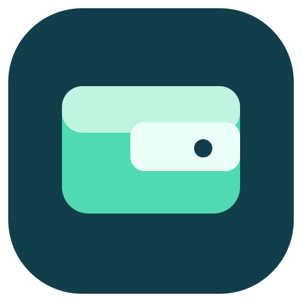
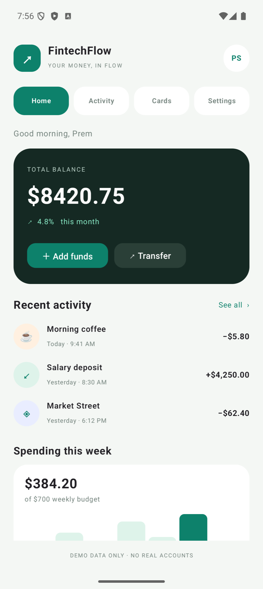

# FintechFlow KMP



A Kotlin Multiplatform finance dashboard with a shared Compose interface for Android, iOS, and desktop. It uses fictional in-memory data only; it does not connect to banks or payment services.

## Android preview



## Features

- Home dashboard with balance, weekly budget, and sample activity.
- Browse Activity, Cards, and Preferences screens.
- Add sample funds or make a demo transfer and see the balance update.
- Freeze and unfreeze the sample card.
- Switch between light and dark themes.
- Run the same shared UI on Android, iOS, and desktop.

## Open and run

Open this folder in Android Studio with JDK 17 and Android SDK 35. Run the `androidApp` configuration on an emulator or device. To run desktop, use `:shared:run`. The iOS framework targets `iosArm64` and `iosSimulatorArm64`; Xcode is required to build and launch an iOS application.

## Structure

```text
androidApp/              Android entry point and launcher icon
shared/src/commonMain/   Shared Compose UI and app behavior
shared/src/iosMain/      iOS Compose controller
shared/src/desktopMain/  Desktop Compose entry point
```

Kotlin Multiplatform 2.1.21, Compose Multiplatform 1.8.2, Android Gradle Plugin 8.7.2, Gradle 8.12.1, and JDK 17.

All account data is fictional demo content held in memory. This is a portfolio UI demonstration only.
